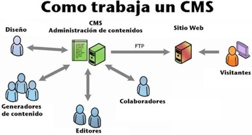

## ¿Qué es un CMS y cómo funciona?

Un Sistema de Gestión de Contenidos (CMS) es una aplicación web que permite crear, administrar y publicar contenidos digitales a través de una interfaz gráfica, sin necesidad de programar. Funciona mediante un panel de administración privado donde los usuarios gestionan las entradas y páginas; al realizar una acción, esta información se almacena en una base de datos (como MySQL o PostgreSQL) y, cada vez que un visitante accede al sitio, el servidor procesa la petición en tiempo real, ejecuta las consultas necesarias y ensambla dinámicamente el código HTML que se envía al navegador.  

## Tipos de gestores de contenido y ejemplos

- **Por su propósito:** pueden tener un propósito general o estar especializados en algo, como E-commerce, o educativos.
  - *Ejemplos:*
    - **WordPress:** de propósito general (sirve para blogs, webs corporativas, etc.).
    - **Shopify:** especializado en comercio electrónico (E-commerce).
    - **Moodle:** especializado en el ámbito educativo (plataforma de aprendizaje / LMS).

- **Por su arquitectura:** pueden ser acoplados, donde el backend y el frontend están en un único bloque, o desacoplados, que no tienen capa de presentación, solo exponen los datos para ser consumidos por cualquier cliente.
  - *Ejemplos:*
    - **Drupal (o Joomla):** arquitectura tradicional acoplada (gestión de datos y plantillas visuales en el mismo servidor).
    - **Strapi:** arquitectura desacoplada / *Headless* (backend de código abierto que expone contenido mediante API REST o GraphQL).
    - **Sanity:** arquitectura desacoplada / *Headless* basada en la nube.

## CMS dinámico frente a Generador de sitios estáticos (SSG)

| Aspecto | CMS dinámico | Generador estático |
| --- | --- | --- |
| **Forma de crear contenidos** | Editor visual en panel web (usuario/contraseña). | Archivos de texto plano (.md) en local con editor de código. |
| **Base de datos** | Sí, imprescindible (MySQL, MariaDB, etc.). | No requiere; el contenido vive en los propios ficheros. |
| **Generación del HTML** | En tiempo real en el servidor con cada visita. | Previa; se compila todo antes de subirlo al servidor. |
| **Servidor necesario** | Dinámico con intérprete (PHP, Node) y base de datos. | Servidor web simple (Nginx, Apache) o almacenamiento CDN. |
| **Panel de administración** | Sí, integrado por defecto. | No incluye panel nativo. |
| **Conocimientos técnicos** | Básicos; no requiere programar ni usar terminal. | Manejo de Markdown, terminal, Git y plantillas. |
| **Seguridad** | Mayor riesgo (inyecciones SQL, plugins, accesos). | Muy alta (sin backend activo ni base de datos). |
| **Rendimiento** | Variable y dependiente de caché y consultas. | Ultrarrápido; sirve archivos planos directamente. |
| **Actualización del contenido** | Instantánea al guardar en el panel. | Requiere recompilar y desplegar el proyecto. |
| **Publicación** | Directa desde el panel del CMS. | Vía Git (CI/CD) o subida directa de archivos generados. |
| **Ejemplos** | WordPress, Drupal, Joomla, PrestaShop. | Hugo, Jekyll, Astro, 11ty. |

---
👉 [Ver vídeo explicativo sobre CMS](https://www.youtube.com/watch?v=sSh5AAmItN0&t=25s)  
👉 [Ir a la investigación sobre SSG](ssg.md)